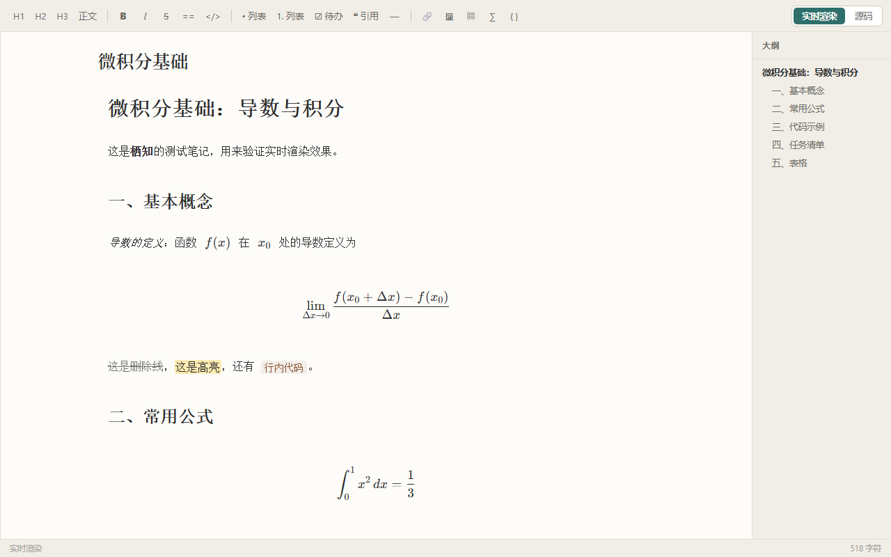
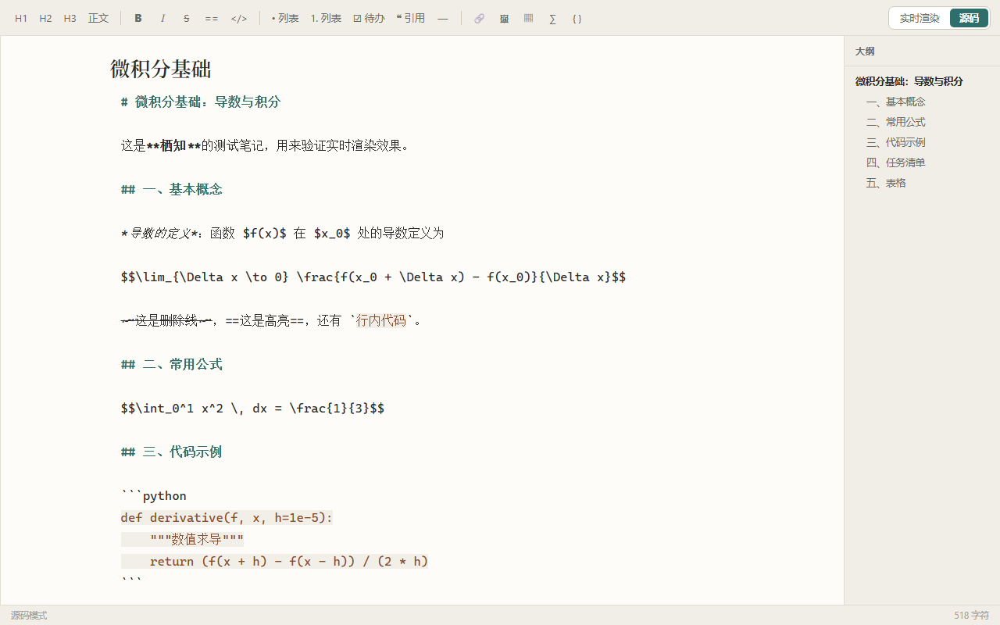

# 栖知 Peryx

> 以 Markdown 书写，让知识在这里筑巢。

个性化本地 Markdown 学习笔记软件。笔记就是你自己文件夹里的 `.md` 文件，不锁定格式，随时可以用任何编辑器打开。

当前版本：**v0.1.0** —— 完成核心笔记功能。


**实时渲染模式**（隐藏 Markdown 符号，直接看到排版效果）：



**源码模式**（显示完整语法，便于精确编辑）：



---

## 已实现功能（v0.1）

- **笔记库**：选择任意本地文件夹作为笔记库；也可新建一个（自动生成欢迎笔记）
- **目录树**：嵌套文件夹 + `.md` 文件；新建 / 重命名 / 删除（右键或 `⋯` 菜单）
- **双模式编辑器**：实时渲染 ↔ 源码模式一键切换
- **Markdown 快捷工具栏**：16 个命令，不懂 Markdown 也能写
  - 标题 H1/H2/H3、正文、加粗、斜体、删除线、高亮、行内代码
  - 无序列表、有序列表、任务列表、引用、分割线
  - 链接、图片、表格、数学公式、代码块（均带插入对话框）
- **公式**：LaTeX 行内 `$...$` 与块级 `$$...$$`，带实时预览
- **代码块**：语法高亮（highlight.js）
- **图片**：选择本地图片自动复制到 `assets/`，插入相对路径
- **自动保存**：停止输入 800ms 自动写盘；`Ctrl+S` 手动保存；关闭窗口前保存
- **大纲面板**：提取标题，点击跳转
- **路径安全**：所有文件操作强制限制在笔记库目录内，防越界

## 快捷键

| 快捷键 | 功能 |
|---|---|
| `Ctrl + N` | 新建笔记 |
| `Ctrl + Shift + N` | 新建文件夹 |
| `Ctrl + S` | 保存 |
| `Ctrl + O` | 刷新目录树 |
| `Ctrl + Shift + P` | 切换实时渲染 / 源码模式 |
| `Ctrl + B` | 加粗 |
| `Ctrl + I` | 斜体 |
| `Ctrl + Shift + S` | 删除线 |
| `Ctrl + E` | 行内代码 |
| `Ctrl + K` | 插入链接 |
| `Ctrl + Shift + K` | 插入代码块 |
| `Ctrl + F` | 编辑器内查找 |

---

## 开发

### 环境要求

- Node.js ≥ 20（当前用 24.14.1）
- Rust stable（当前 1.100.0，MSVC 工具链）
- Visual Studio 的「使用 C++ 的桌面开发」工作负载
- WebView2 Runtime（Win10 1803+ 自带）

运行环境自检：

```powershell
powershell -NoProfile -ExecutionPolicy Bypass -File .\check-env.ps1
```

### 常用命令

```powershell
npm install                           # 安装依赖（也可用 pnpm）
npx tauri dev                         # 开发模式（前端热更新；改 Rust 需重启该进程）
npx tauri build --debug --no-bundle   # 只编译 exe，不打包
npx tauri build                       # 生产构建 + NSIS 安装包
cargo test --manifest-path src-tauri/Cargo.toml   # Rust 单元测试
npx tsc --noEmit                      # 前端类型检查
npm run test:click                    # UI 点击定位回归测试（需先跑 npx tauri dev）
```

> ⚠️ **改了代码没生效？** 若直接双击运行 `peryx.exe`，必须先重新
> `npx tauri build --debug --no-bundle`，否则跑的还是旧二进制。用 `npx tauri dev` 时前端会自动热更新。

> ⚠️ **在 cmd 里不要带 `#` 注释**
> `cmd.exe` 不把 `#` 当注释。下面这种写法会把整段注释当成参数传给 cargo，报
> `error: unexpected argument '#' found`：
>
> ```cmd
> npx tauri build --debug --no-bundle    # 确保是最新代码   ← 错误
> ```
>
> 正确做法：只用 PowerShell（`#` 可用），或在 cmd 里去掉注释、改用 `REM`。
> 本 README 里所有示例都是 **PowerShell** 写法。

### 目录结构

```
D:\Peryx
├─ src/                     # React 前端
│  ├─ components/           # Sidebar 目录树、Toolbar 工具栏、Outline 大纲、Welcome 欢迎页…
│  ├─ editor/
│  │  ├─ MarkdownEditor.tsx # CodeMirror 6 编辑器组件
│  │  ├─ livePreview.ts     # 实时渲染扩展（Decoration 就地渲染）
│  │  ├─ commands.ts        # 编辑命令（工具栏与快捷键共用）
│  │  └─ theme.ts           # 编辑器主题
│  ├─ lib/
│  │  ├─ api.ts             # Tauri 命令的 TS 封装
│  │  ├─ markdown.ts        # Markdown 渲染管线（markdown-it + KaTeX + hljs）
│  │  └─ types.ts
│  ├─ stores/app.ts         # Zustand 全局状态
│  └─ styles/global.css
├─ src-tauri/
│  ├─ src/commands.rs       # 文件系统命令 + 路径越界防护 + 单元测试
│  ├─ src/lib.rs            # Tauri 入口与命令注册
│  ├─ capabilities/         # 权限配置
│  └─ tauri.conf.json
├─ check-env.ps1            # 环境自检
└─ DEVELOP.md               # 完整开发规划与路线图
```

## 技术栈

| 层 | 选型 |
|---|---|
| 桌面壳 | Tauri v2（2.12.x） |
| 前端 | React 18 + TypeScript + Vite 6 |
| 编辑器 | CodeMirror 6 |
| Markdown | markdown-it 15 + KaTeX 0.19 + highlight.js 11 |
| 状态 | Zustand 5 |

## 设计原则

1. **本地优先**：数据就是你自己的文件，不做私有格式封装
2. **不学 Markdown 也能用**：所有语法都有工具栏入口
3. **可扩展内核**：文件读写全部收敛到 `commands.rs` 一层，将来接到同步、双链、AI agent 都从这一层扩展

## 后续规划

见 [DEVELOP.md](./DEVELOP.md)。路线图概要：

- v0.2 知识连接：双链 `[[ ]]`、反向链接、全局搜索、标签
- v0.3 编辑体验增强：Markdown 大纲折叠、导出 PDF、主题切换
- v0.4 同步：WebDAV / 自建服务端 + 冲突合并
- v0.5 学科工具插件：法条案例库、数学绘图、电路图
- v0.6 语言学习：单词库、复习算法
- v0.7 P2P 学习共享
- v0.8 AI Agent：笔记问答 + 出题解析
- Android 端：Tauri v2 移动端复用同一套前端
