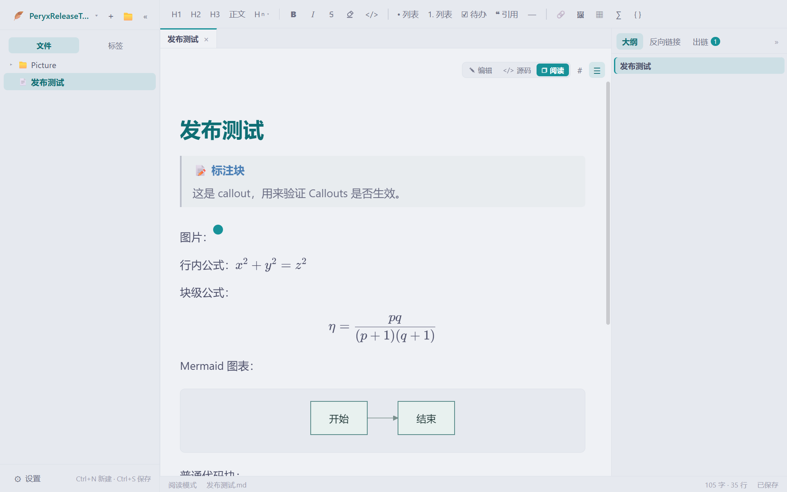

# 栖知 Peryx

> 以 Markdown 书写，让知识在这里筑巢。

个性化本地 Markdown 学习笔记软件。笔记就是你自己文件夹里的 `.md` 文件，不锁定格式，随时可以用任何编辑器打开。

当前版本：**v0.3.0** —— 笔记与资料同处一库（属性 / 别名 / 上下分屏 / PDF 阅读 / 导出 PDF）


**实时渲染模式**（隐藏 Markdown 符号，直接看到排版效果）：


**源码模式**（显示完整语法，便于精确编辑）：


**阅读模式**（一个符号都不显示，适合阅读与分享）：



---

## 为什么做这个

Obsidian 好用，但对不熟悉 Markdown 的人有门槛；Typora 轻，但缺少知识管理。

Peryx 的目标是**既保留本地文件的可控性，又不用先学语法**：
所有 Markdown 语法都有工具栏按钮，同时提供类似 Word 的即时排版观感。

## 功能

### 编辑体验

- **三种视图**：编辑（实时渲染）/ 源码 / 阅读，每篇笔记各自记忆自己的模式
- **光标行展开**：光标移到哪一行，该行的 Markdown 标记（`###`、`**`、`>`、`$...$`）就显示出来，方便精确修改
- **Markdown 快捷工具栏**：16 个命令，不懂 Markdown 也能写
  - 标题 H1/H2/H3 + `Hₙ` 下拉补齐 H4–H6、正文、加粗、斜体、删除线、高亮、行内代码
  - 无序列表、有序列表、任务列表、引用、分割线
  - 链接、图片、表格、数学公式、代码块（均带插入对话框）
- **任务列表可点击**：复选框直接点，不用改源码
- **代码块语法高亮**（highlight.js，支持 100+ 语言）
- **链接可跳转**：`Ctrl/Cmd + 点击` 用系统浏览器打开
- **图片**：选本地图片自动复制到 `assets/`，插入相对路径

### 阅读与排版（v0.2.1）

- **标注块（Callouts）**：`> [!note] 标题` 支持 17 种类型（note / tip / warning / danger / bug / question / example / todo …），各有配色与图标
- **脚注**：正文 `[^1]` + 文末 `[^1]: 解释`，按出现顺序编号，点上标跳文末、点 ↩ 跳回
- **Mermaid 图表**：```` ```mermaid ```` 直接渲染成图，语法错误显示提示不白屏（按需加载，不拖慢首屏）
- **块级公式**：阅读态只留渲染结果，点击即回到源码
- **大纲滚动跟随**：滚动时右侧大纲高亮当前章节，并自动滚进可视区

### 公式与表格

- **LaTeX 公式**：行内 `$...$` 与块级 `$$...$$`，KaTeX 渲染
- **编辑时保留预览**：改公式源码时，下方仍然显示渲染结果
- **表格是真正的表格**：渲染为 HTML `<table>`，列宽自动对齐、表头加粗
  - **点击单元格就地编辑**（Obsidian 风格），公式、粗体在单元格内也会渲染
  - 聚焦单元格时显示原始 Markdown，失焦自动写回

### 多笔记与分屏（v0.2.1 / v0.3）

- **标签页**：同时打开多篇笔记，点击切换、中键或 × 关闭、右键「关闭其它 / 全部」
- **标签页是统一容器**：笔记、PDF 资料、图片都能进标签，标签上带格式徽标 `MD` / `PDF` / `IMG`
- **四向分屏**：拖动标签页到编辑区**四条边**即可分屏（左 / 右 / 上 / 下），标签会**移动**过去而不是复制
- **分屏有自己的标签栏**：两个面板各自切换、各自关闭，互不干扰
- **分屏独立视图**：左边阅读、右边编辑可以同时进行
- 关闭分屏时，它的标签会自动还回主面板，不会丢

### 笔记属性与别名（v0.3）

- **YAML 属性面板**：笔记顶部可视化编辑 frontmatter，可就地改值、增删属性
- **列表型属性**（`aliases` / `tags`）用胶囊展示，回车添加、× 删除
- **三种视图下的显示规则**：编辑态显示折叠的属性面板（正文里不重复 YAML）；源码态只看 YAML 源码；阅读态完全不展示
- **别名**：`aliases: [另一个名字]`，`[[另一个名字]]` 也能定位到这篇笔记

### 资料库与 PDF 阅读（v0.3）

- **一个小分区**：左侧边栏上下分开，上半是笔记库、下半是资料库，互不串味
- **资料导入**：资料库右上角 `+`，可多选文件复制进来；同名自动改名，不覆盖原件
- **PDF 阅读器**：连续滚动、按需渲染、页码跳转、8 档缩放
- **隔离**：资料库目录不出现在笔记树里，md 文件也不出现在资料库里
- 目前保证 PDF 能读；docx / pptx / xlsx 先列出，后续版本支持

### 导出 PDF（v0.3）

- 笔记右上角 `⤓` 导出，走系统打印对话框「另存为 PDF」
- A4 页边距、代码块背景、表格边框、callout 配色都写进了打印样式
- 图片内联为 data URL、Mermaid 转内联 SVG、frontmatter 不进正文

### 外观（v0.2.1）

- **主题预设**：默认（Catppuccin Latte）/ 默认深色（Mocha）/ 墨绿 / 护眼 / 纸白
- **自定义样式**：在主题之上再调正文、H1–H3、加粗、斜体、删除线、高亮、引用、列表、链接的颜色 / 字体 / 缩放 / 粗细
- **字号与行高**：滑杆实时预览
- **设置窗口**：Obsidian 式左栏导航 + 右内容，可拖拽调整窗口大小并记住尺寸
- **快捷键可视化录制**：13 个动作可改，带冲突检测与逐项恢复

### 文件与笔记库

- **笔记库**：选择任意本地文件夹；也可新建（自动生成欢迎笔记）
- **仓库切换**：点左上角笔记库名称即可在多个库之间切换
- **记住上次打开的库**：下次启动直接进入，不用重新选择
- **目录树**：嵌套文件夹 + `.md` 文件 + 图片；新建 / 重命名 / 删除
- **自然排序**：`CPP-2` 排在 `CPP-10` 前面（和 Obsidian 一致），文件夹优先
- **手动排序**：右键文件夹可切换「手动排序」，直接拖动条目调整顺序
- **自定义排序**：每个文件夹可独立选择按名称或手动
- **自动保存**：停止输入 800ms 自动写盘；`Ctrl+S` 手动保存；关窗保存
- **路径安全**：所有文件操作强制限制在笔记库目录内，防越界

### 知识连接（v0.2）

- **双向链接**：写 `[[笔记名]]` 建立链接，点击跳转；`[[笔记名|别名]]` 可自定义显示文字
- **待创建链接**：指向不存在的笔记时显示灰色虚线，点击直接创建
- **链接自动补全**：输入 `[[` 弹出候选列表
- **反向链接面板**：右侧显示「哪些笔记引用了我」，含上下文片段与行号，点击跳转
- **出链面板**：查看当前笔记引用了哪些笔记
- **命令面板** `Ctrl+P`：按标题 / 路径模糊搜索，回车跳转
- **全局搜索** `Ctrl+Shift+F`：搜索所有笔记正文，结果按笔记分组并高亮命中
- **标签**：正文写 `#标签` 自动识别，侧边栏「标签」页签可浏览与筛选
- **标签重命名**：批量替换所有笔记里的标签，代码块内的不会被误改
- **图片嵌入**：`![[图片.jpg]]` 只写文件名也能找到（自动在整库搜索，支持 `Picture/` 之类的子目录）

## 快捷键

| 快捷键 | 功能 |
|---|---|
| `Alt + 1` | 显示 / 隐藏左侧边栏 |
| `Alt + 4` | 显示 / 隐藏右侧边栏 |
| `Alt + 0` | 打开设置 |
| `Ctrl + N` | 新建笔记 |
| `Ctrl + Shift + N` | 新建文件夹 |
| `Ctrl + S` | 保存 |
| `Ctrl + O` | 刷新目录树 |
| `Ctrl + P` | 命令面板（按标题跳转） |
| `Ctrl + Shift + F` | 全局全文搜索 |
| `Ctrl + Shift + P` | 切换实时渲染 / 源码模式 |
| `Ctrl + B` | 加粗 |
| `Ctrl + I` | 斜体 |
| `Ctrl + Shift + S` | 删除线 |
| `Ctrl + E` | 行内代码 |
| `Ctrl + K` | 插入链接 |
| `Ctrl + Shift + K` | 插入代码块 |
| `Ctrl + F` | 编辑器内查找 |
| `Ctrl + 点击链接` | 用系统浏览器打开 / 编辑双链 |

以上快捷键都可以在 **设置 → 快捷键** 里改成自己的组合。

---

## 安装

从 [Releases](https://github.com/NakikaML/Peryx/releases) 下载：

- **`Peryx_0.3.0_x64-setup.exe`** —— NSIS 安装包，推荐
- 安装后从开始菜单启动「栖知 Peryx」

系统要求：Windows 10 1803+ / Windows 11，需要 WebView2 Runtime（Win11 自带，Win10 通常已随 Edge 安装）。

## 开发

### 环境要求

- Node.js ≥ 20（当前用 24.14.1）
- Rust stable（当前 1.100.0，MSVC 工具链）
- Visual Studio 的「使用 C++ 的桌面开发」工作负载
- WebView2 Runtime（Win10 1803+ 自带）

运行环境自检：

```powershell
powershell -NoProfile -ExecutionPolicy Bypass -File .\check-env.ps1
```

### 常用命令

```powershell
npm install                           # 安装依赖（也可用 pnpm）
npx tauri dev                         # 开发模式（前端热更新；改 Rust 需重启该进程）
npx tauri build --debug --no-bundle   # 只编译 exe，不打包
npx tauri build                       # 生产构建 + NSIS 安装包
cargo test --manifest-path src-tauri/Cargo.toml   # Rust 单元测试
npx tsc --noEmit                      # 前端类型检查
```

### 测试

前端测试基于 Chrome DevTools Protocol 模拟真实鼠标事件，验证「点击位置是否落在预期字符上」这类
光看代码发现不了的问题。运行前需先启动开发服务器（`npx tauri dev` 或 `npx vite --port 1420`）：

```powershell
npm run test:click    # 点击定位（实时渲染 / 源码两种模式）
npm run test:live     # Obsidian 式展开交互
npm run test:issues   # 8 项交互需求
npm run test:table    # 表格单元格就地编辑
npm run test:math     # 公式编辑时保留渲染
npm run test:sort     # 自然排序 + 拖拽排序
npm run test:links    # 反向链接面板
npm run test:search   # 命令面板 + 全局搜索
npm run test:wiki     # [[双链]] 渲染
npm run test:complete # [[ 自动补全
npm run test:tags     # #标签 渲染与筛选
```

v0.2.1 新增的脚本（在 `scripts/` 下，用 `node scripts/xxx.mjs` 直接跑）：

| 脚本 | 覆盖内容 |
|---|---|
| `test-reading-mode.mjs` | 阅读模式：无源码残留、双链/图片/标签、双击回编辑 |
| `test-callouts.mjs` | 标注块：类型区分、标记隐藏与展开 |
| `test-footnotes.mjs` | 脚注：编号、脚注区、双向跳转 |
| `test-mermaid.mjs` | Mermaid：SVG 渲染、语法错误提示、普通代码块不受影响 |
| `test-outline-follow.mjs` | 大纲滚动跟随 |
| `test-tabs.mjs` | 标签页：累加、切换、关闭 |
| `test-split.mjs` | 分屏：开启、编辑写盘、阅读态、关闭 |
| `test-side-tabs.mjs` | 分屏自己的标签栏 |
| `test-tab-drag-pointer.mjs` | 拖标签分屏（**真实鼠标事件**） |
| `test-pane-mode.mjs` | 每篇笔记的模式切换 |
| `test-theme.mjs` | 主题预设与自定义覆盖 |
| `test-image-embed.mjs` / `test-image-resolve.mjs` | 图片嵌入与按文件名全库解析 |
| `test-caret-inside.mjs` | 光标能点进 `![[…]]` / `[[…]]` 内部 |
| `test-math-bold.mjs` | 加粗里的公式、块公式阅读态 |
| `test-v021.mjs` | 右侧边栏合并、Hₙ 下拉、荧光笔图标、Alt+1/Alt+4 |
| `test-real-app-*.mjs` | 通过 WebView2 CDP 在**真实 exe** 里验证 |

v0.3 新增：

| 脚本 | 覆盖内容 |
|---|---|
| `test-properties.mjs` | YAML 属性面板：改值 / 加列表项 / 加属性 / 删属性 / 别名解析 |
| `test-frontmatter-hidden.mjs` | 三种视图下 frontmatter 的显示规则 |
| `test-vsplit.mjs` | 上下分屏：高度分配、不溢出、两侧都有内容 |
| `test-pdf-export.mjs` | 导出 PDF 的打印 HTML：A4 / 图片内联 / Mermaid SVG |
| `test-resources.mjs` | 资料库隔离 + PDF 阅读（页数、canvas 有内容、翻页、缩放） |
| `test-resource-import.mjs` | 资料导入：复制、同名改名、格式校验 |
| `test-tab-kind.mjs` | 标签页统一容器：MD / PDF 徽标、切换、关闭 |
| `test-settings-window.mjs` | 设置窗口：左右栏、拖拽调整大小、尺寸记忆 |
| `test-style-apply.mjs` | 样式修改真的生效（断计算样式，不只看变量） |
| `test-list-bullet.mjs` | 列表圆点：光标行由 `-` 顶替，有序列表不画圆点 |

> ⚠️ **改了代码没生效？** 若直接双击运行 `peryx.exe`，必须先重新
> `npx tauri build --debug --no-bundle`，否则跑的还是旧二进制。用 `npx tauri dev` 时前端会自动热更新。

> ⚠️ **在 cmd 里不要带 `#` 注释**
> `cmd.exe` 不把 `#` 当注释。下面这种写法会把整段注释当成参数传给 cargo，报
> `error: unexpected argument '#' found`：
>
> ```cmd
> npx tauri build --debug --no-bundle    # 确保是最新代码   ← 错误
> ```
>
> 正确做法：只用 PowerShell（`#` 可用），或在 cmd 里去掉注释、改用 `REM`。
> 本 README 里所有示例都是 **PowerShell** 写法。

### 目录结构

```
Peryx
├─ src/                     # React 前端
│  ├─ components/           # Sidebar 目录树、Toolbar 工具栏、TabStrip 标签栏、SplitPane 分屏…
│  │                        # RightSidebar（大纲/反链/出链）、SettingsPanel、ReadingView…
│  ├─ editor/
│  │  ├─ MarkdownEditor.tsx # CodeMirror 6 编辑器组件
│  │  ├─ livePreview.ts     # 实时渲染扩展（Decoration 就地渲染）
│  │  ├─ commands.ts        # 编辑命令（工具栏与快捷键共用）
│  │  ├─ linkHandler.ts     # 链接点击跳转
│  │  └─ theme.ts           # 编辑器主题
│  ├─ lib/
│  │  ├─ api.ts             # Tauri 命令的 TS 封装
│  │  ├─ markdown.ts        # Markdown 渲染管线（markdown-it + KaTeX + hljs + Callouts + 脚注）
│  │  ├─ theme.ts           # 主题预设（CSS 变量）
│  │  ├─ settings.ts        # 设置模型、持久化、快捷键匹配
│  │  ├─ tabDrag.ts         # 标签拖拽（指针事件实现）
│  │  ├─ mermaid.ts         # Mermaid 渲染（动态 import）
│  │  ├─ imageCache.ts      # 图片 data URL 缓存
│  │  └─ types.ts
│  ├─ stores/app.ts         # Zustand 全局状态（标签页 / 分屏 / 设置）
│  └─ styles/global.css
├─ src-tauri/
│  ├─ src/commands.rs       # 文件系统命令 + 路径越界防护 + 排序 + 单元测试
│  ├─ src/index.rs          # 笔记索引（双链/标签/附件）
│  ├─ src/lib.rs            # Tauri 入口、启动时恢复笔记库并建索引
│  ├─ capabilities/         # 权限配置
│  └─ tauri.conf.json
├─ scripts/                 # CDP 自动化测试
├─ check-env.ps1            # 环境自检
└─ DEVELOP.md               # 完整开发日志、踩坑记录与路线图
```

## 技术栈

| 层 | 选型 |
|---|---|
| 桌面壳 | Tauri v2（2.12.x） |
| 前端 | React 18 + TypeScript + Vite 6 |
| 编辑器 | CodeMirror 6 |
| Markdown | markdown-it 15 + KaTeX 0.19 + highlight.js 11 |
| 图表 | Mermaid 11（按需加载） |
| 状态 | Zustand 5 |

## 设计原则

1. **本地优先**：数据就是你自己的文件，不做私有格式封装
2. **不学 Markdown 也能用**：所有语法都有工具栏入口
3. **可扩展内核**：文件读写全部收敛到 `commands.rs` 一层，将来接到同步、双链、AI agent 都从这一层扩展
4. **验证优先于宣称**：每个交互都有对应的自动化测试，改完先跑测试再下结论

## 已知限制

- 目前仅支持 Windows（macOS / Linux 理论上可编译，未测试）
- 中文按 Unicode 码点排序，暂不支持拼音排序
- 拖动排序仅支持同一目录内，不支持跨文件夹拖动
- 表格暂不支持增删行列（仅支持改单元格内容）
- **分屏最多两个面板**（不支持继续往外拖出第三个）
- **资料库只保证 PDF 能读**；docx / pptx / xlsx 目前只列出、不能预览
- 导出 PDF 走系统打印对话框，不是静默生成文件（系统限制）
- 尚未支持：笔记嵌入 `![[另一篇笔记]]`、块引用 `^id`、关系图谱、Canvas、未链接提及、每日笔记、模板、书签

## 后续规划

见 [DEVELOP.md](./DEVELOP.md)。路线图概要：

- v0.3 笔记与资料同处一库：YAML 属性、别名、四向分屏、PDF 阅读、资料库导入、导出 PDF
- v0.4 资料库增强：资料全文搜索、PDF 标注与书签、docx / pptx / xlsx 预览
- v0.4+ 知识网络：关系图谱、块引用、未链接提及、每日笔记、模板
- v0.5 同步：WebDAV / 自建服务端 + 冲突合并
- v0.6 学科工具插件：法条案例库、数学绘图、电路图
- v0.7 语言学习：单词库、复习算法（SRS）
- v0.8 P2P 学习共享
- v0.9 AI Agent：笔记问答 + 出题解析
- Android 端：Tauri v2 移动端复用同一套前端

## 许可证

MIT

